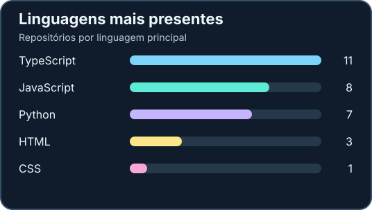

# Felipe Toledo

Desenvolvedor web e analista de sistemas, com foco em front-end, dados e automação. Trabalho com tecnologia na educação e também com gestão de tráfego e mensuração de campanhas.

Estudei História e Relações Internacionais e hoje curso Análise e Desenvolvimento de Sistemas. Fora do trabalho, gosto de criar jogos, ler e descobrir como as coisas funcionam.

[**Portfólio**](https://toledo-felipe.vercel.app/portfolio) · [LinkedIn](https://www.linkedin.com/in/felipetoledo8/) · [E-mail](mailto:felipe.toledo.ads@gmail.com)

## Ferramentas de trabalho

- **Web:** TypeScript, React, Next.js, Tailwind CSS e Leaflet.
- **Dados e automação:** Python, Pandas, Flask, Streamlit e PostgreSQL.
- **Marketing e mensuração:** Google Ads, Meta Ads, LinkedIn Ads, GA4 e GTM.

## Meu GitHub em números

<!-- stats:start -->
| Repositórios públicos | Estrelas recebidas | Repositórios com push nos últimos 90 dias |
| ---: | ---: | ---: |
| 30 | 3 | 14 |

Dados da API do GitHub, atualizados em 25/11/2026. Apenas repositórios públicos próprios, sem forks, arquivados ou este README. Cada projeto conta uma vez na sua linguagem principal.
<!-- stats:end -->

[Ver contribuições no GitHub](https://github.com/lipe404#contribution-graph)
